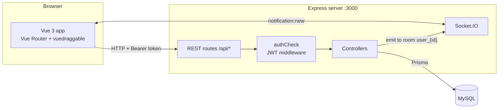
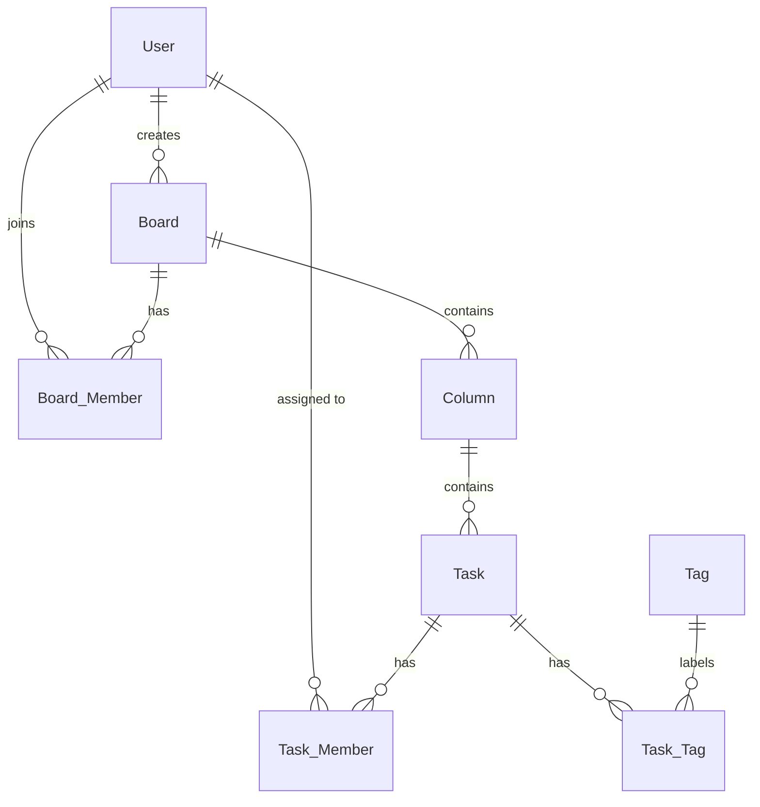

# Kanban Board

A collaborative Kanban board where teams create boards, invite members, assign tasks and drag cards between columns. Members get a real-time notification when they're added to a board or assigned to a task.

<!-- TODO: add a screenshot or GIF, e.g. docs/demo.gif -->
<!--  -->

## Features

- **Boards and columns:** create, rename and delete boards with any number of columns (To Do, In Progress, Done, …)
- **Tasks:** create, edit and delete tasks with a description, tags and assignees
- **Drag and drop:** move tasks between columns; the new column is saved through the API
- **Team boards:** invite members by email and see boards you own or were invited to
- **Real-time notifications:** Socket.IO pushes a message the moment you're added to a board or assigned a task
- **Authentication:** register and log in with bcrypt-hashed passwords and JWT; protected routes on both the API and the Vue router

## Tech stack

| Layer | Tools |
|---|---|
| Frontend | Vue 3, Vue Router, Tailwind CSS, vuedraggable, Headless UI, Axios, socket.io-client |
| Backend | Node.js, Express 5, Socket.IO, JSON Web Tokens, bcryptjs |
| Database | MySQL via Prisma ORM (schema and migrations in `server/prisma`) |

## Architecture



Each logged-in client joins a Socket.IO room named `user_{id}`. When a controller adds someone to a board or a task, it emits `notification:new` to that user's room, so only the affected person is notified.

## Data model



Deleting a board cascades to its columns, tasks, members and tag links.

## API overview

All routes are prefixed with `/api`. Every route except `register` and `login` needs an `Authorization: Bearer <token>` header.

| Area | Endpoints |
|---|---|
| Auth | `POST /register`, `POST /login`, `POST /current-user` |
| Boards | `POST /createBoard`, `GET /listBoard`, `GET /readBoard/:id`, `PUT /updateBoard/:id`, `DELETE /deleteBoard/:id` |
| Columns | `POST /createColumn`, `GET /listColumn/:boardId`, `GET /readColumn/:id`, `PUT /updateColumn/:id`, `DELETE /deleteColumn/:id` |
| Tasks | `POST /createTask`, `GET /listTask`, `GET /readTask/:id`, `PUT /updateTask/:id`, `PUT /moveTask/:id`, `DELETE /deleteTask/:id` |
| Members | `POST /addMember`, `GET /listMember/:boardId`, `GET /user?email=`, `GET /userInBoard/:boardId`, `DELETE /deleteMember/:id` |
| Notifications | `GET /notification` |

## Run it locally

Requirements: Node.js 18+ and a MySQL server.

**1. API**

```bash
git clone https://github.com/naruemon09/Kanban-board.git
cd Kanban-board/server
npm install
cp .env.example .env          # then fill in SECRET and DATABASE_URL
npx prisma migrate dev        # creates the tables
npm start                     # http://localhost:3000
```

**2. Frontend** (in a second terminal)

```bash
cd Kanban-board/kanban
npm install
npm run dev                   # http://localhost:5173
```

Register an account, create a board, then register a second account in a private window and invite it to see notifications arrive live.

## Project structure

```
Kanban-board/
├── kanban/                 # Vue 3 frontend
│   └── src/
│       ├── api/            # Axios calls, one file per resource
│       ├── components/     # Board, Column, CardTask, Notification, …
│       └── router.js       # route guard checks the JWT before entering the app
└── server/                 # Express API
    ├── controllers/        # business logic per resource
    ├── middlewares/        # authCheck (JWT)
    ├── routes/             # auto-loaded into /api
    └── prisma/             # schema.prisma and migrations
```

## What I'd improve next

- Check that the user belongs to the board on every column and task endpoint, not only on board listing
- Return `401` instead of `500` when a token is invalid or expired
- Move the API base URL into a `VITE_API_URL` environment variable so the frontend can be deployed
- Persist the order of tasks inside a column, not just which column they're in
- Add API tests with Jest and Supertest, and a GitHub Actions workflow to run them
